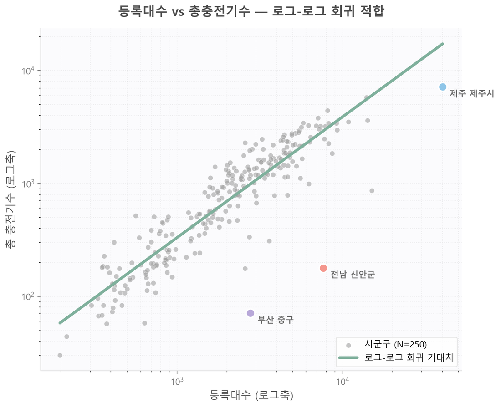
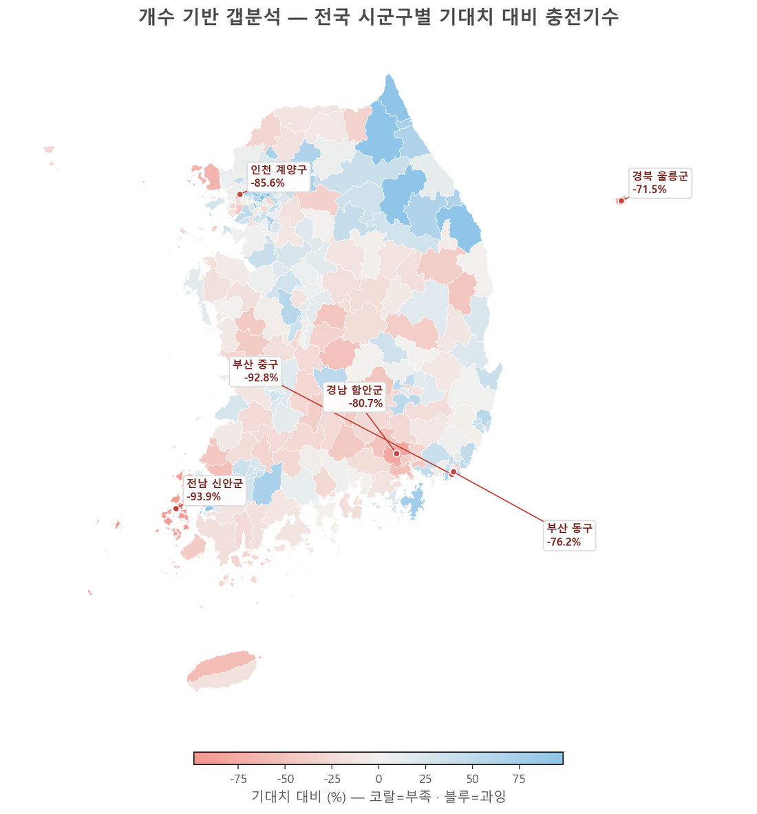
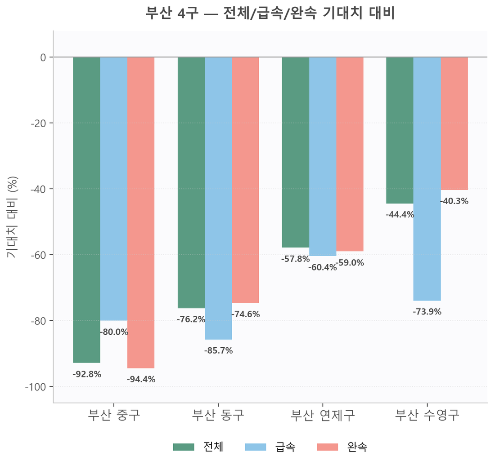
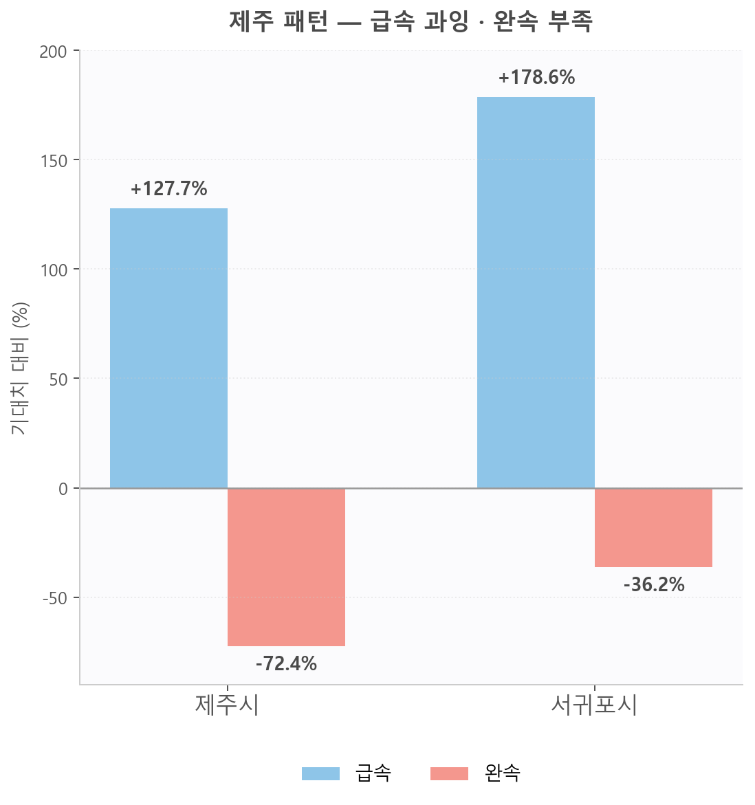
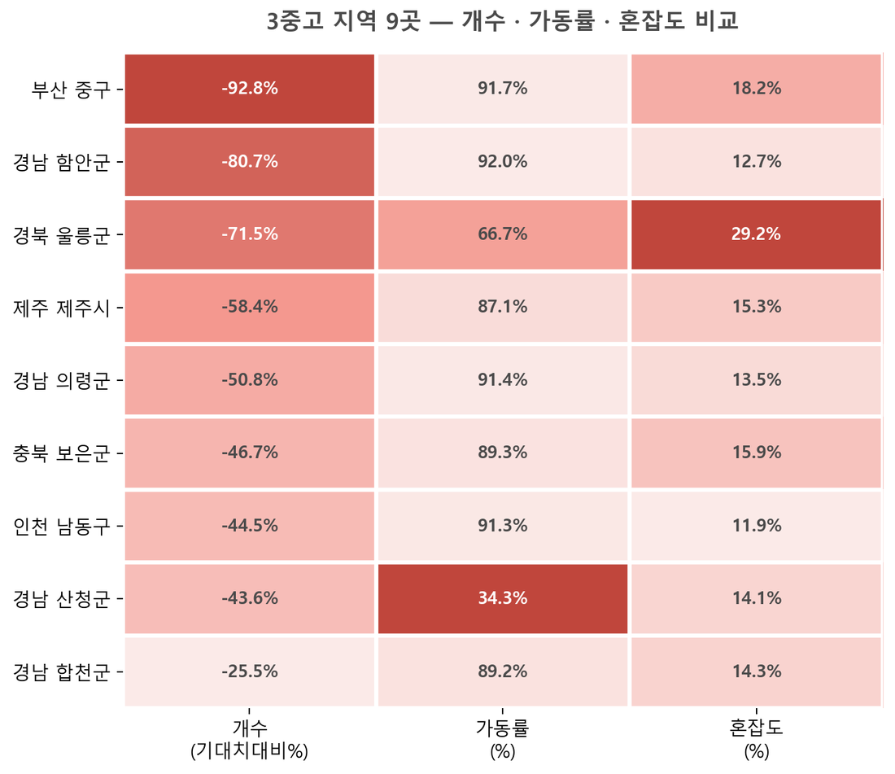
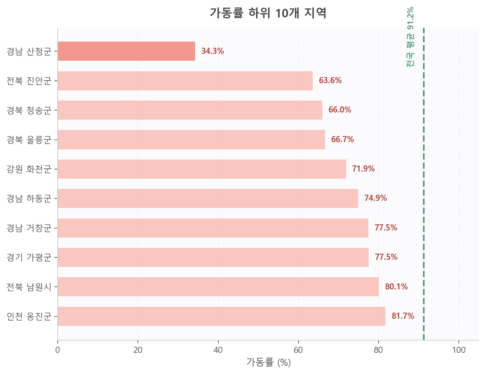
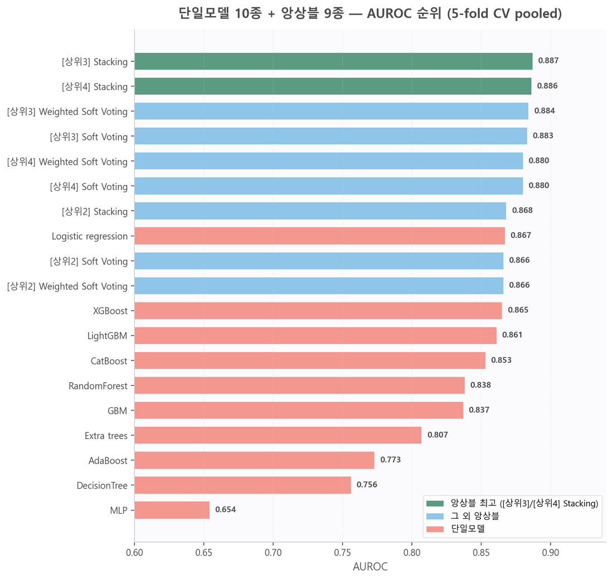
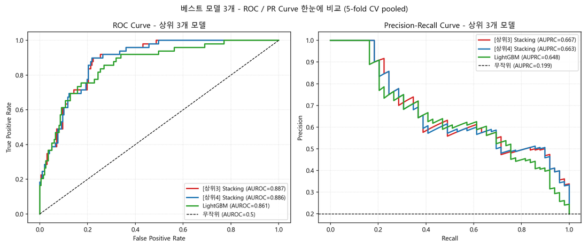
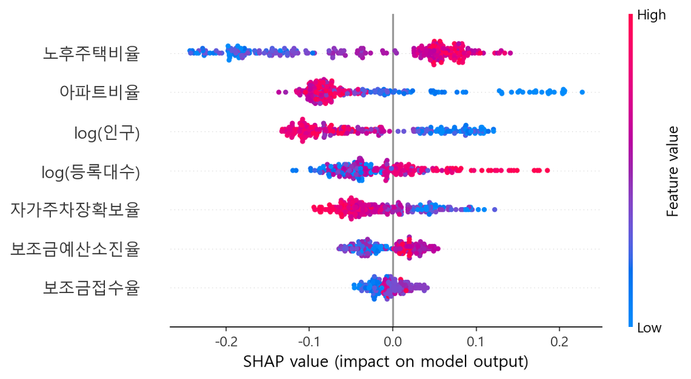
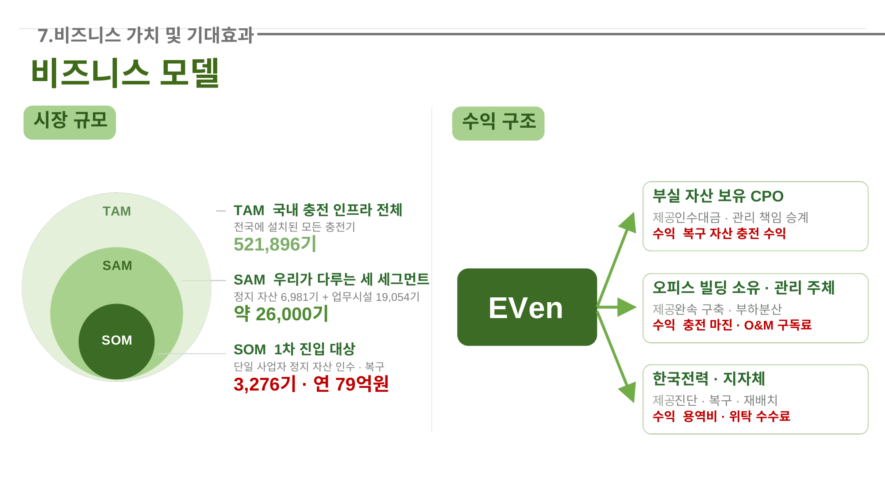

<div align="center">

# ⚡ EVen — 전기차 충전 인프라 갭 분석 및 예측

### 4개 축 진단과 결핍지역 예측 모델


</div>

---

## 🏆 수상

| | |
| --- | --- |
| **🏆 대상** | **2026 BigData Summer School** (Snowflake) — Team EVen |

## 📌 프로젝트 정보

| | |
| --- | --- |
| **프로젝트명** | 전기차 충전 인프라 갭 분석 및 예측 — 4개 축 진단과 결핍지역 예측 모델 |
| **행사** | 2026 BigData Summer School (Snowflake) |
| **팀** | Team **EVen** (4인) |
| **기간** | 2026.08 |
| **발표자료** | [📄 EVen_presentation.pdf](docs/EVen_presentation.pdf) (24쪽) |
| **스택** | Snowflake (Snowpark · Dynamic Table · Model Registry · Streamlit in Snowflake) · Python · scikit-learn · XGBoost · LightGBM · CatBoost · SHAP |

## 💡 문제 정의

충전기는 47만 대를 넘었지만, 전기차 이용자의 상당수는 여전히 충전 불편을 겪는다고 보도됩니다. 문제는 **충전기의 "개수"가 아니라 "어디에, 어떤 상태로 있느냐"** 입니다.

> **가설** — *"충전 인프라의 분포는 지역 규모에 따라 결정된다"*
> ① 이 가설이 데이터로도 성립하는지 검증하고, ② 실제로 **어디가, 왜 부족한지**를 찾는다.

## 🔎 분석 요약

| 구분 | 내용 |
| --- | --- |
| **데이터** | 전국 전기차 충전소 표준데이터 525,894행 · 충전소 위치 및 운영정보 272,282행 · 차종별 등록대수 508행 (한국환경공단 · 한국교통안전공단) + 통계청 SGIS(아파트·노후주택·자가주차장·인구), 보조금 현황 |
| **전처리** | 도로명 주소 → (시도, 시군구) 정규화 → 시군구 단위 집계 → 충전기 10대 미만 제외 → **분석 단위 229~250개 시군구** |
| **4개 축 지표** | ① 기대치 대비 **괴리율** ② 실제 **가동률** ③ **혼잡도** ④ 충전기 **3중고** 지역 |
| **예측 모델** | 괴리율 하위 20%를 "결핍(1)"으로 라벨링한 이진 분류 · 246개 시군구(양성 49개) · 19개 모델 비교 |

### 1. 기대치 대비 괴리율 — 가설 검증

충전기 절대 수는 대도시가 유리하므로, **로그-로그 회귀**로 "등록대수 대비 기대 충전기 수"를 구하고 실제와의 차이(괴리율)로 비교했습니다.

`log(충전기수) = β₀ + β₁ · log(등록대수)` → **R² = 0.672**

<div align="center">


</div>

괴리율 하위 20개 지역의 규모 구성은 **대규모 9곳 > 소규모 7곳 > 중규모 4곳**. → **"충전 인프라의 분포는 지역 규모에 따라 결정되지 않는다"** (가설 기각)

### 2. 지역별 패턴 — 급속/완속을 나눠 보면 다른 문제가 보입니다

| 부산 4구 (급속·완속 모두 부족) | 제주 (급속 과잉 / 완속 부족) |
| --- | --- |
| 중구 −92.8% · 동구 −76.2% · 연제구 −57.8% · 수영구 −44.4% | 제주시 급속 +127.7% / 완속 −72.4%<br>서귀포시 급속 +178.6% / 완속 −36.2% |

<div align="center">


</div>

### 3. 가동률 · 혼잡도 · 3중고

- 전국 평균 가동률 **91.2%**, 최저는 경남 산청군 **34.3%**(고장률 63.0%).
- **개수 부족 + 가동률 낮음 + 혼잡도 높음**이 겹치는 **3중고 지역 9곳**: 부산 중구 · 경남 함안군 · 경북 울릉군 · 제주시 · 경남 의령군 · 충북 보은군 · 인천 남동구 · 경남 산청군 · 경남 합천군

<div align="center">


</div>

### 4. 결핍지역 예측 모델

- **라벨:** 괴리율 하위 20% = 결핍(1) · 표본 246개 시군구, 양성 49개(19.9%)
- **설명 변수:** 등록대수, 인구, 아파트 비율, 노후주택 비율, 자가주차장 확보율, 보조금 접수율·예산소진율
- **평가:** 표본이 작아 단일 분할 평가가 불안정하므로 **전 모델 동일 5-fold Stratified CV, pooled out-of-fold, Youden's J 임계값**으로 비교
- **결과:** 단일 10개 + 앙상블 9개, 총 19개 비교. 상위 3개 모델(LR+XGBoost+LightGBM)을 묶은 **Stacking 앙상블이 AUROC 0.887**(발표 당시 소프트 보팅 0.888)로 최고, 단일 모델 최고는 로지스틱 회귀 0.867

<div align="center">


</div>

**SHAP** — 결핍 예측에 가장 크게 기여한 변수는 노후주택 비율, 아파트 비율, 인구 규모 순이었습니다.

<div align="center">

</div>

## ❄️ Snowflake 활용

데이터 적재부터 모델 등록, 앱 배포, 자동 갱신까지 **Snowflake 안에서** 처리했습니다.

| 단계 | 도구 | 처리 |
| --- | --- | --- |
| 1. 데이터 적재 | Internal Stage + `COPY INTO` | 원본 6종 적재 (한글 CSV는 CP949) |
| 2. 주소 정규화 | Snowpark Python UDF | 도로명 주소 → (시도, 시군구) 키 변환 |
| 3. 지표 집계 | Dynamic Table | 충전기 수 · 급속/완속 · 상태별 집계 |
| 4. 통합 패널 | View | 세 테이블을 (시도, 시군구)로 조인 → 250개 시군구 단일 공급원 |
| 5. 분석·모델링 | Snowflake Notebooks + Snowpark DataFrame | 로그-로그 회귀 → 괴리율 → 결핍 라벨 → 19개 모델 비교 |
| 6. 모델 등록 | Model Registry | pkl 파일 대신 버전 관리되는 모델 저장 |
| 7. 앱 배포 | Streamlit in Snowflake | 테이블 직접 조회 (별도 CSV 배포 불필요) |
| 8. 자동 갱신 | Task | 충전기 상태 일 단위 재적재 → 지표·앱 자동 반영 |

## 📈 비즈니스 가치

- **TAM** 국내 충전 인프라 전체 521,896기 → **SAM** 약 26,000기(정지 자산 6,981기 + 업무시설 19,054기) → **SOM** 1차 진입 3,276기, 연 79억 원
- 전국 52만 건 수집·정제·집계에 78시간이 걸리던 작업을 파이프라인으로 **6.05초**에 재실행 (−99.8%)

<div align="center">

</div>


## 📁 폴더 구조

```
.
├── src/
│   ├── ev_full_pipeline.py          # 전체 파이프라인 (데이터 준비 → 괴리율 → 가동률 → 혼잡도 → 4축 통합 → 예측 모델)
│   ├── model_all_cv5_youden.py      # 19개 모델 비교 (5-fold CV + Youden's J)
│   ├── snowflake_analysis.sql       # Snowflake SQL 재현 (REGR_* 집계 함수로 회귀 · 괴리율)
│   └── streamlit_app.py             # Streamlit in Snowflake 대시보드
├── data/
│   ├── snowflake_upload_ready/      # Snowflake 적재용 시군구 집계 테이블 6종
│   ├── scratch_*.csv, *.xlsx        # 모델 스크립트 입력 및 결과 (소규모 집계본)
├── docs/
│   ├── images/                      # 분석 차트
│   ├── slides/                      # 발표자료 발췌
│   └── EVen_presentation.pdf        # 발표자료 전문
└── requirements.txt
```

## 🚀 재현 방법

원본 충전소 데이터(약 230MB)는 용량 때문에 포함하지 않았습니다. 공공데이터 출처에서 내려받아 `data/`에 두면 `src/ev_full_pipeline.py`로 전체를 재현할 수 있습니다.

| 데이터 | 출처 |
| --- | --- |
| 전국 전기차 충전소 표준데이터 / 충전소 위치 및 운영정보 | 한국환경공단 (공공데이터포털) |
| 전국 전기차 차종별·용도별 차량 등록대수 | 한국교통안전공단 |
| 아파트·노후주택·자가주차장 확보율·인구 | 통계청 SGIS |
| 무공해차 보조금 현황 | 환경부 / 한국환경공단 |

**모델 비교만 바로 재현하기** — 모델 입력(집계본)은 `data/`에 들어 있습니다.

```powershell
pip install -r requirements.txt
python src/model_all_cv5_youden.py
```

> `src/streamlit_app.py`는 **Streamlit in Snowflake** 전용이라 로컬에서는 실행되지 않습니다. (Snowsight의 Streamlit 앱에 붙여넣어 실행, `PROJECT.EV` 스키마의 테이블 사용)

## 👥 팀 EVen

**송은지** · 이권석 · 이채우 · 유지후

## 데이터 출처 및 유의사항

- 모든 데이터는 공공데이터 및 통계청 SGIS 공개 자료입니다. 각 데이터의 이용 조건은 원 출처를 따릅니다.
- 시군구 단위 집계 결과이며, 개별 충전소의 실시간 상태를 보장하지 않습니다.
